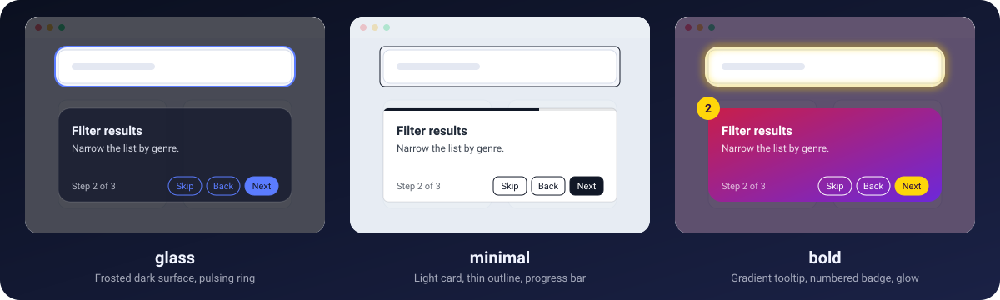
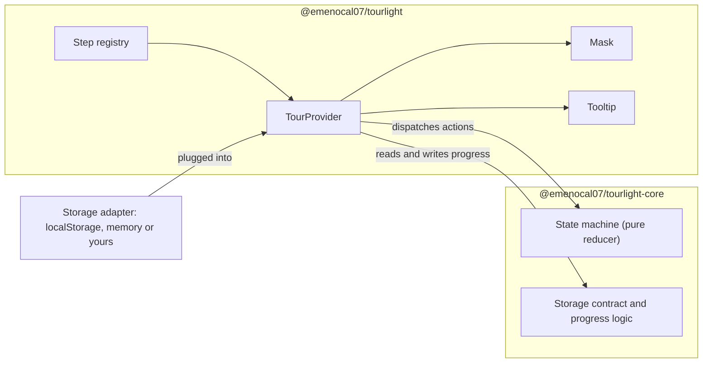

<p align="center">
  
</p>

<h1 align="center">Tourlight</h1>

<p align="center">
  <strong>Guided product tours for React: a spotlight, a tooltip, and the types to keep them honest.</strong>
</p>

<p align="center">
  <a href="https://github.com/emenocal07/tourlight/blob/main/LICENSE"></a>
  
  
  
</p>

<p align="center">
  <a href="#-quick-start">Quick start</a> ·
  <a href="#-variants">Variants</a> ·
  <a href="#-theming">Theming</a> ·
  <a href="#-persistence">Persistence</a> ·
  <a href="#-accessibility">Accessibility</a> ·
  <a href="#-api-reference">API</a> ·
  <a href="#-development">Development</a>
</p>

> **Status:** `0.1.0` is not published to npm yet. Until it is, clone the repo or install from a packed tarball (see [Quick start](#-quick-start)).

## ✨ Why Tourlight

- **Declarative.** Describe the tour once with `createTour`, then wrap the elements you want to explain in `<TourStep id="...">`. No imperative selectors, no extra DOM node.
- **Type-checked step ids.** The id union is inferred from your config keys, so a typo in `<TourStep id="serach">` is a compile error, not a tour that silently skips a step.
- **Accessible by default.** A labelled dialog, a focus trap that restores focus, keyboard navigation, a polite live region and `prefers-reduced-motion` support are built in, not an add-on.
- **Themeable with CSS variables.** Pick a variant, pass a `theme`, or override `--tour-*` variables in your own stylesheet.
- **Remembers who has seen it.** Built-in "show N times" persistence with a pluggable storage adapter (sync or async).

## 🚀 Quick start

```bash
npm install @emenocal07/tourlight
```

Not on npm yet? Pack both packages and install the tarballs together (the React package depends on the core package at the same version):

```bash
git clone https://github.com/emenocal07/tourlight.git && cd tourlight
npm ci && npm run build
mkdir -p ../tourlight-packs
npm pack -w @emenocal07/tourlight-core -w @emenocal07/tourlight --pack-destination ../tourlight-packs
# then, in your app:
npm install ../tourlight-packs/*.tgz
```

Create the tour at **module scope**, import the stylesheet once, then wrap the elements to highlight:

```tsx
import { createTour } from "@emenocal07/tourlight";
import "@emenocal07/tourlight/style.css";

// Module scope: created once, never during render.
const { TourProvider, TourStep, useTour } = createTour(
  {
    search: {
      order: 1,
      title: "Search",
      content: "Find any record in seconds.",
    },
    share: {
      order: 2,
      title: "Share",
      content: "Send a report with one click.",
      placement: "bottom-end",
    },
  },
  { maxShows: 2 },
);

function Toolbar() {
  const { start } = useTour();
  return (
    <header>
      <TourStep id="search">
        <input placeholder="Search" />
      </TourStep>
      <TourStep id="share">
        <button type="button">Share</button>
      </TourStep>
      <button type="button" onClick={start}>
        Take the tour
      </button>
    </header>
  );
}

export function App() {
  return (
    <TourProvider variant="glass">
      <Toolbar />
    </TourProvider>
  );
}
```

Step ids are checked at compile time:

```tsx
function Broken() {
  return (
    // @ts-expect-error: "settings" is not a step id of this tour
    <TourStep id="settings">
      <div />
    </TourStep>
  );
}
```

The tour starts by itself the first time (see [Persistence](#-persistence)) and can be started manually with `useTour().start()`.

## 🎨 Variants

<p align="center">
  
</p>

| Variant             | Look                                                               |
| ------------------- | ------------------------------------------------------------------ |
| `glass`             | Dark dim, pulsing ring, frosted translucent tooltip.               |
| `minimal` (default) | Light dim, thin outline, white card with a progress bar.           |
| `bold`              | Red-to-violet gradient tooltip, numbered badge, glowing highlight. |

```tsx
<TourProvider variant="bold">{/* ... */}</TourProvider>;
```

## 🧩 Features

|     | Feature           | Details                                                        |
| --- | ----------------- | -------------------------------------------------------------- |
| 🧭  | Typed step ids    | `TourStep id` is the union of your config keys.                |
| 🔦  | Spotlight mask    | The hole transitions in position and size between steps.       |
| 💬  | Smart tooltip     | Positioned with Floating UI: offset, flip, shift and an arrow. |
| 🎭  | Three variants    | `glass`, `minimal`, `bold`.                                    |
| 🎚️  | Design tokens     | Five CSS variables, per-variant defaults.                      |
| 💾  | Show N times      | `maxShows` plus a custom storage adapter.                      |
| ⌨️  | Keyboard          | Escape skips, arrow keys navigate, Tab stays in the tooltip.   |
| ♿  | Screen readers    | Dialog semantics and a polite live region.                     |
| 🖱️  | Interactive steps | `interactive: true` lets clicks through the hole.              |
| 📏  | Tall targets      | Highlights the visible part and docks the tooltip when needed. |
| 🌐  | SSR-safe          | The overlay mounts after hydration.                            |

## 🎛️ Theming

Pass a partial `theme` to the provider. Only the keys you pass are applied; everything else keeps the variant default.

```tsx
<TourProvider variant="glass" theme={{ primary: "#7c3aed", radius: "20px" }}>
  {/* ... */}
</TourProvider>;
```

Or override the public CSS variables in your own stylesheet:

```css
:root {
  --tour-primary: #7c3aed;
  --tour-radius: 20px;
}
```

| Variable         | `theme` key | Controls                             |
| ---------------- | ----------- | ------------------------------------ |
| `--tour-primary` | `primary`   | Buttons, outline, ring and glow.     |
| `--tour-surface` | `surface`   | Tooltip background.                  |
| `--tour-text`    | `text`      | Tooltip text.                        |
| `--tour-radius`  | `radius`    | Tooltip and spotlight corner radius. |
| `--tour-dim`     | `dim`       | Color of the dimmed overlay.         |

Per-variant defaults (they live in internal `--tour-default-*` variables, which the public ones fall back to, so your overrides never fight selector specificity or source order):

| Variant   | primary   | surface   | text      | radius | dim                        |
| --------- | --------- | --------- | --------- | ------ | -------------------------- |
| `glass`   | `#5b7cff` | `#151a2e` | `#f1f4ff` | `14px` | `rgba(6, 9, 22, 0.72)`     |
| `minimal` | `#111827` | `#ffffff` | `#1f2937` | `6px`  | `rgba(226, 232, 240, 0.7)` |
| `bold`    | `#ffd60a` | `#c81e4a` | `#ffffff` | `16px` | `rgba(30, 10, 50, 0.7)`    |

The overlay is rendered in a portal under `document.body`, so set the variables on `:root`, `body` or `.tourlight-root`. A wrapper `div` around your app is not an ancestor of the overlay. The `theme` prop is written inline on the overlay root, so it wins over values set in CSS.

## 📍 Placement

Twelve values: `top`, `bottom`, `left`, `right`, each with a `-start` or `-end` suffix (`top-start`, `top-end`, `bottom-start`, and so on).

`bottom-start` puts the tooltip below the target with their left edges aligned; `bottom-end` aligns the right edges.

Placement is a preference: if the tooltip does not fit on that side, it flips to the opposite one and is shifted to stay inside the viewport. Set it for every step on the provider, or per step in the config (the step wins):

```tsx
<TourProvider placement="bottom-start">
  {/* default for all steps */}
</TourProvider>;
// per step: { order: 2, title: "...", content: "...", placement: "right" }
```

## 💾 Persistence

- `maxShows` (default `1`): the tour starts automatically while it has been shown fewer than `maxShows` times and has not been finished. Every start counts as a show, including manual `start()` calls.
- Finishing or skipping marks the tour as completed, so it never auto-starts again, whatever is left of `maxShows`.
- `storageKey`: where progress is saved. The default is derived from the step ids ordered by `order`: `tourlight:` followed by the ids joined with commas (for example `tourlight:search,share`), so two different tours do not share progress. Set it explicitly to keep progress stable when you rename or add steps.
- The default storage is `localStorage`, wrapped so that a missing or full `localStorage` simply means nothing is persisted.

Plug in your own storage with the `storage` prop. `getItem` and `setItem` may be synchronous or return a promise:

```tsx
import type { TourStorage } from "@emenocal07/tourlight";

const remoteStorage: TourStorage = {
  async getItem(key) {
    const response = await fetch(
      `/api/tour-progress/${encodeURIComponent(key)}`,
    );
    return response.ok ? response.text() : null;
  },
  async setItem(key, value) {
    await fetch(`/api/tour-progress/${encodeURIComponent(key)}`, {
      method: "PUT",
      body: value,
    });
  },
};

// <TourProvider storage={remoteStorage}>...</TourProvider>
```

Read failures count as "no progress yet"; write failures are swallowed, and the in-memory progress stays authoritative for the session.

`createLocalStorageAdapter()` and `createMemoryStorage(initial?)` are re-exported for convenience (the memory one is handy in tests and Storybook).

## ♿ Accessibility

- The tooltip is a `role="dialog"` with `aria-labelledby` (title) and `aria-describedby` (content).
- Focus moves into the tooltip when a step opens, is trapped there (Tab and Shift+Tab cycle), and returns to the previously focused element when the tour ends.
- Keyboard: `Escape` skips the tour, `ArrowRight` goes to the next step, `ArrowLeft` to the previous one. Modified arrows (Alt, Ctrl, Meta, Shift), held keys and arrows typed inside inputs, textareas, selects or editable content are ignored. `Escape` during an IME composition is ignored too.
- A visually hidden `aria-live="polite"` region announces `Now on step N of M: title` (the title is appended when it is a plain string).
- `prefers-reduced-motion: reduce` turns off the transitions and animations.
- The default palettes of the three variants are checked against WCAG AA contrast.

## 📏 Tall targets and scroll lock

- Each step scrolls its target into view: centered, or aligned to the top when the target is taller than the viewport.
- Only the visible part of the target is highlighted. If the tooltip fits neither before nor after the visible part along the placement axis (above or below, or left or right), it docks at the bottom center of the viewport.
- `lockScroll` (default `true`) hides the page scrollbar while the tour is active, compensating the layout shift, so users cannot scroll the page away from the highlighted element. Programmatic scrolling between steps still works. Pass `lockScroll={false}` to leave scrolling alone.

## 📚 API reference

<details>
<summary><code>createTour(config, options?)</code></summary>

```ts
function createTour<const C extends Record<string, StepConfig>>(
  config: C,
  options?: TourOptions,
): { TourProvider; TourStep; useTour };
```

Validates the config (at least one step, no duplicate `order`), orders the steps by `order`, and returns components bound to this tour. `TourStep`'s `id` is typed as `keyof C & string`.

| `StepConfig` field | Type            | Notes                                                                                |
| ------------------ | --------------- | ------------------------------------------------------------------------------------ |
| `order`            | `number`        | Required. Unique per tour; steps run in ascending order.                             |
| `title`            | `ReactNode`     | Required.                                                                            |
| `content`          | `ReactNode`     | Required.                                                                            |
| `interactive`      | `boolean`       | Default `false`. When `true`, clicks reach the highlighted element through the hole. |
| `placement`        | `TourPlacement` | Overrides the provider's `placement` for this step.                                  |

| `TourOptions` field | Type     | Default                                         |
| ------------------- | -------- | ----------------------------------------------- |
| `maxShows`          | `number` | `1`                                             |
| `storageKey`        | `string` | `tourlight:` + ordered step ids joined with `,` |

</details>

<details>
<summary><code>TourProvider</code> props</summary>

| Prop         | Type                                                                              | Default                |
| ------------ | --------------------------------------------------------------------------------- | ---------------------- |
| `children`   | `ReactNode`                                                                       | required               |
| `variant`    | `"glass" \| "minimal" \| "bold"`                                                  | `"minimal"`            |
| `theme`      | `Partial<TourTheme>` (`primary`, `surface`, `text`, `radius`, `dim`: all strings) | variant defaults       |
| `storage`    | `TourStorage`                                                                     | `localStorage` adapter |
| `lockScroll` | `boolean`                                                                         | `true`                 |
| `placement`  | `TourPlacement`                                                                   | `"bottom"`             |

</details>

<details>
<summary><code>TourStep</code></summary>

```tsx
<TourStep id="search">
  <input />
</TourStep>;
```

Takes exactly one child element and clones it with a ref, so it adds no DOM node. The child must forward its ref to a DOM node: DOM elements work as they are; a custom component must pass its ref on (React 19 function components receive `ref` as a prop; on React 18 use `forwardRef`). A ref you put on the child yourself keeps working.

A step whose element is not mounted, hidden or zero-sized is skipped (with a development-only `console.warn` for unmounted ones).

</details>

<details>
<summary><code>useTour()</code></summary>

Must be called under the matching `TourProvider`, otherwise it throws.

| Member     | Description                                                                    |
| ---------- | ------------------------------------------------------------------------------ |
| `start()`  | Starts the tour at its first available step. A no-op while the tour is active. |
| `next()`   | Goes to the next step; on the last step it completes the tour.                 |
| `prev()`   | Goes to the previous step.                                                     |
| `skip()`   | Ends the tour and marks it completed.                                          |
| `finish()` | Ends the tour and marks it completed.                                          |
| `isActive` | `true` while the tour is running.                                              |

</details>

<details>
<summary><code>TourStorage</code>, <code>TourProgress</code>, <code>TourPlacement</code>, <code>TourTheme</code>, <code>TourVariant</code></summary>

```ts
interface TourStorage {
  getItem(key: string): string | null | Promise<string | null>;
  setItem(key: string, value: string): void | Promise<void>;
}

interface TourProgress {
  shown: number;
  completed: boolean;
}

type TourPlacement =
  | "top"
  | "top-start"
  | "top-end"
  | "bottom"
  | "bottom-start"
  | "bottom-end"
  | "left"
  | "left-start"
  | "left-end"
  | "right"
  | "right-start"
  | "right-end";
```

Progress is stored as `JSON.stringify(progress)` under the storage key. Also exported: `TourApi`, `TourProviderProps`, `StepConfig`, `TourOptions`, `TourTheme`, `TourVariant`, `createLocalStorageAdapter`, `createMemoryStorage`.

</details>

## ⚠️ Good to know

- Call `createTour` at module scope, never during render. Each call creates a separate tour with its own context.
- Changing the step ids changes the default storage key, so users who finished the old tour see the new one again. Set `storageKey` to keep progress.
- `start()` while the tour is active does nothing, and a tour with no visible steps does not start.
- In the Next.js App Router, the module that calls `createTour` needs `"use client"`.
- Two tours at once are not supported.
- Keyboard users cannot Tab to the target of an `interactive` step: focus is trapped in the tooltip. Pointer users can click it.

## 🌍 Compatibility

- React 18 and 19 (`react` and `react-dom` peer range `>=18`).
- Modern evergreen browsers.
- SSR-safe: nothing is portaled during server rendering; the overlay mounts after hydration.

## 🏗️ Architecture



## 📦 Packages

| Package                                       | Description                                                                                 |
| --------------------------------------------- | ------------------------------------------------------------------------------------------- |
| [`@emenocal07/tourlight`](packages/web)       | React bindings: `createTour`, provider, mask, tooltip, styles. This is the one you install. |
| [`@emenocal07/tourlight-core`](packages/core) | Framework-agnostic state machine and storage contract. No React, no DOM.                    |
| [`example`](apps/example)                     | Private Vite playground, not published.                                                     |

## 🛠️ Development

```bash
npm ci
npm run test        # builds core, then runs the test suite
npm run typecheck
npm run build
npm run lint        # Biome
npm run smoke       # packs both packages and checks them from a clean consumer
```

Run the playground (build first so the workspace packages have their `dist`):

```bash
npm run build
npm run dev -w example
```

Releases are driven by [Changesets](https://github.com/changesets/changesets): `npm run changeset` to describe a change, `npm run version-packages` to apply versions.

## 🤝 Contributing

Issues and pull requests are welcome at [github.com/emenocal07/tourlight](https://github.com/emenocal07/tourlight/issues). Please run `npm run test`, `npm run typecheck` and `npm run lint` before opening a PR.

## 📄 License

[MIT](LICENSE) © 2026 Ernesto Espinoza Menocal
